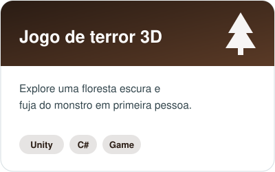
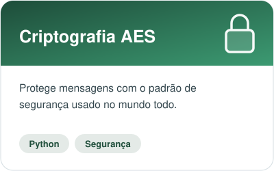
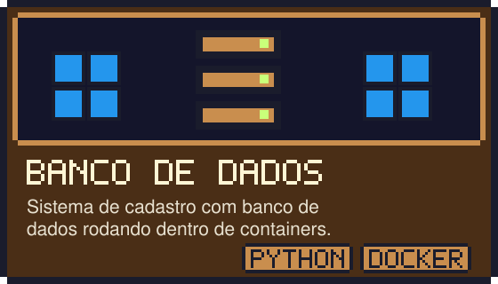
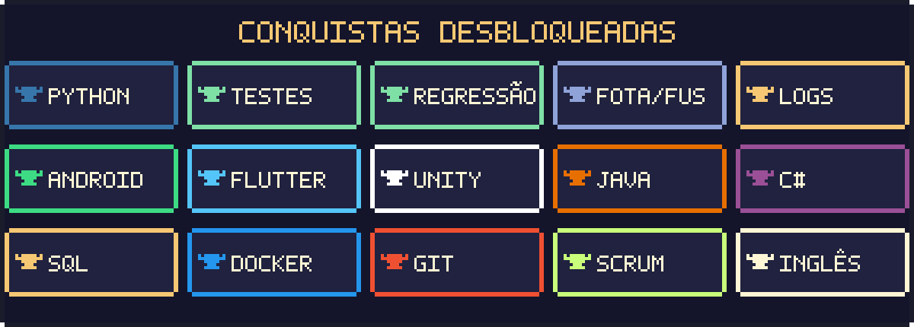

## 👾 Oi! Eu sou o André

Moro em **Manaus**, estudo **Ciência da Computação na UNIP** e passo o dia caçando bugs no **Sidia**, o instituto que desenvolve tecnologia para a **Samsung**.

Meu trabalho é simples de explicar: quando seu celular baixa uma atualização, alguém precisa garantir que ela não vai quebrar nada. Esse alguém sou eu (e um time inteiro de gente boa). Eu testo, investigo o que deu errado e escrevo scripts em Python que fazem os testes chatos sozinhos.

No tempo livre eu construo coisas que dá para tocar: um cubo mágico em 3D, um jogo de terror, um app que avisa sobre enchentes na Amazônia e, agora, um app de leitura com IA.

## 🕹️ Missão atual: Sidia · Samsung

| | O que eu faço | Em português claro |
|:--:|---|---|
| 🧪 | Testes funcionais e de regressão | Confiro se tudo continua funcionando depois de cada mudança |
| 📋 | Casos de teste | Transformo requisitos em um passo a passo do que testar |
| 🐍 | Automação com Python | Faço o computador repetir os testes por mim |
| 🔍 | Análise de logs e causa raiz | Leio o "diário" do sistema até achar onde o bug nasceu |
| 📦 | Validação de firmware (FOTA/FUS) | Garanto que a atualização chega inteira e segura no aparelho |
| 🤝 | Times ágeis | Trabalho junto com o pessoal de hardware e software |

## 🎮 Fases concluídas

<table>
  <tr>
    <td width="50%"></td>
    <td width="50%"></td>
  </tr>
  <tr>
    <td width="50%"></td>
    <td width="50%"></td>
  </tr>
  <tr>
    <td width="50%"></td>
    <td width="50%"></td>
  </tr>
</table>

🔒 AquAlerta e BookMind AI têm código fechado, então os cartões levam ao meu portfólio. As atividades da faculdade ficam em <a href="https://github.com/AndreFecury/faculdade-ciencia-da-computacao">faculdade-ciencia-da-computacao</a>.

## 🗺️ Mapa da jornada

## 🏆 Inventário

## 💬 Player 2, aperte start

  
  
  

Todas as artes deste perfil foram desenhadas pixel por pixel para ele. Nenhum bug foi ferido na produção (todos foram corrigidos).
