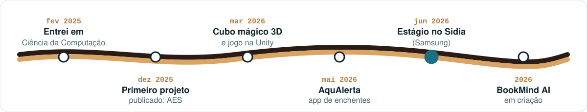
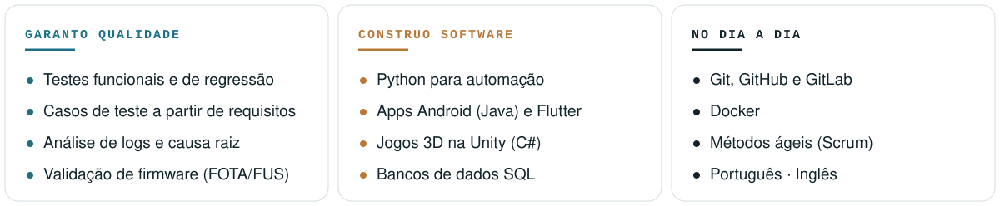

### Quem sou

Sou estudante de Ciência da Computação em Manaus e estagiário no **Sidia**, instituto de tecnologia que desenvolve para a **Samsung**. Meu trabalho é garantir que as atualizações de sistema dos celulares cheguem às pessoas sem erros: eu testo, investigo falhas e automatizo testes com Python.

Fora do estágio, gosto de criar coisas que dá para tocar e usar: um cubo mágico em 3D no celular, um jogo de terror, um app que avisa sobre enchentes na Amazônia e, agora, um app de leitura com inteligência artificial.

### O que faço no Sidia

### Projetos

<table>
  <tr>
    <td width="50%"></td>
    <td width="50%"></td>
  </tr>
  <tr>
    <td width="50%"></td>
    <td width="50%"></td>
  </tr>
  <tr>
    <td width="50%"></td>
    <td width="50%"></td>
  </tr>
</table>

AquAlerta e BookMind AI têm código privado; os cartões levam ao portfólio. Atividades da faculdade em <a href="https://github.com/AndreFecury/faculdade-ciencia-da-computacao">faculdade-ciencia-da-computacao</a>.

### Trajetória

### Competências

### Vamos conversar

  
  
  

