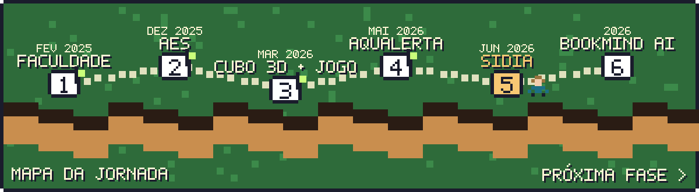

## 👾 Sobre mim

Sou estudante de **Ciência da Computação na UNIP** em Manaus e estagiário de **Software QA & Testes no Sidia**, instituto de P&D que desenvolve tecnologia para a **Samsung**.

No estágio trabalho com validação de firmware Android: testes funcionais e de regressão em atualizações OTA, análise de logs para encontrar a causa raiz de falhas e automação de testes em Python para reduzir trabalho manual e repetitivo.

Fora do estágio, desenvolvo projetos próprios para praticar diferentes stacks: Android nativo em Java, jogos em Unity/C#, apps em Flutter e, no momento, um app de leitura com IA.

## 🕹️ Missão atual: Sidia · Samsung

| | Atividade | Na prática |
|:--:|---|---|
| 🧪 | Testes funcionais e de regressão | Valido builds de firmware e garanto que correções não quebram funcionalidades existentes |
| 📋 | Casos de teste | Escrevo e mantenho casos de teste a partir dos requisitos de cada feature |
| 🐍 | Automação com Python | Scripts que executam testes repetitivos e coletam resultados automaticamente |
| 🔍 | Análise de logs e causa raiz | Investigo logs do sistema para isolar a origem dos defeitos e reportá-los com precisão |
| 📦 | Validação de firmware (FOTA/FUS) | Verifico a integridade e o comportamento das atualizações enviadas aos dispositivos |
| 🤝 | Times ágeis (Scrum) | Atuo junto às equipes de hardware e software no ciclo de desenvolvimento |

## 🎮 Fases concluídas

<table>
  <tr>
    <td width="50%"></td>
    <td width="50%"></td>
  </tr>
  <tr>
    <td width="50%"></td>
    <td width="50%"></td>
  </tr>
  <tr>
    <td width="50%"></td>
    <td width="50%"></td>
  </tr>
</table>

🔒 AquAlerta e BookMind AI têm repositório privado; os cartões levam ao portfólio. As atividades da faculdade ficam em <a href="https://github.com/AndreFecury/faculdade-ciencia-da-computacao">faculdade-ciencia-da-computacao</a>.

## 🗺️ Mapa da jornada

## 🏆 Inventário

## 💬 Player 2, aperte start

  
  
  

Artes em pixel art feitas sob medida para este perfil, geradas como SVG animado.
