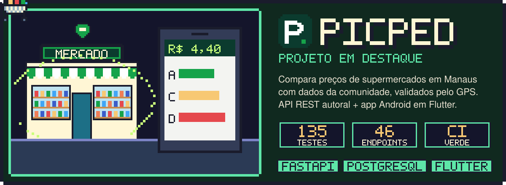
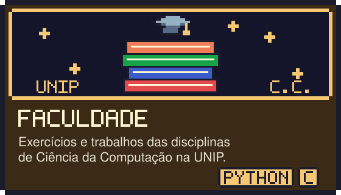
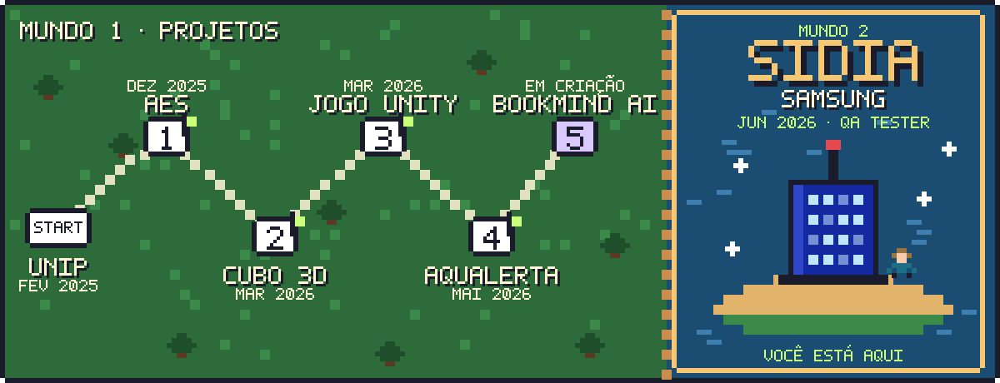

##  Sobre mim

Sou estudante de **Ciência da Computação na UNIP** em Manaus e estagiário de **Software QA & Testes no Sidia**, instituto de P&D que desenvolve tecnologia para a **Samsung**.

No estágio trabalho com validação de firmware Android: testes funcionais e de regressão em atualizações OTA, análise de logs para encontrar a causa raiz de falhas e automação de testes em Python para reduzir trabalho manual e repetitivo.

Fora do estágio, desenvolvo projetos próprios em diferentes stacks: o **Picped**, plataforma de comparação de preços com API em FastAPI e PostgreSQL e app em Flutter, apps Android nativos em Kotlin e Java, um jogo em Unity/C# e, no momento, um app de leitura com IA.

##  Missão atual: Sidia · Samsung

| Atividade | Na prática |
|---|---|
|  Testes funcionais e de regressão | Valido builds de firmware e garanto que correções não quebram funcionalidades existentes |
|  Casos de teste | Escrevo e mantenho casos de teste a partir dos requisitos de cada feature |
|  Automação com Python | Scripts que executam testes repetitivos e coletam resultados automaticamente |
|  Análise de logs e causa raiz | Investigo logs do sistema para isolar a origem dos defeitos e reportá-los com precisão |
|  Validação de firmware (FOTA/FUS) | Verifico a integridade e o comportamento das atualizações enviadas aos dispositivos |
|  Times ágeis (Scrum) | Atuo junto às equipes de hardware e software no ciclo de desenvolvimento |

##  Projetos em destaque

### [Picped](https://github.com/AndreFecury/picped) · comparador de preços de supermercados

API REST autoral em **FastAPI e PostgreSQL** e app Android em **Flutter**: os usuários registram preços, o GPS confirma que estão no mercado e a API mostra onde cada produto ou a lista inteira sai mais barato. Feito em equipe com [Luís San Martin](https://github.com/OSan-Martin).

<table>
  <tr>
    <td width="50%" valign="top">
      <h3><a href="https://github.com/AndreFecury/QR-Acesso">QR Acesso</a></h3>
      
      
App Android nativo em <b>Kotlin</b> que guarda o QR Code da catraca da faculdade e o mostra em tela cheia, offline.

    </td>
    <td width="50%" valign="top">
      <h3><a href="https://andrefecury.github.io/#projetos">AquAlerta</a></h3>
      
      
App em <b>Flutter</b> com mapas que avisa quem mora em Manaus quando o rio ameaça subir.  privado

    </td>
  </tr>
  <tr>
    <td width="50%" valign="top">
      <h3><a href="https://github.com/AndreFecury/Cubo-m-gico-3d-Android-em-Java">Cubo mágico 3D</a></h3>
      
      
Cubo mágico 3x3 interativo em 3D para Android, em <b>Java</b>: as faces giram com o toque.

    </td>
    <td width="50%" valign="top">
      <h3><a href="https://github.com/AndreFecury/Jogo-3d-Unity-happy-tree-friends-">Jogo de terror 3D</a></h3>
      
      
Jogo de terror em primeira pessoa feito na <b>Unity</b> com <b>C#</b>.

    </td>
  </tr>
  <tr>
    <td colspan="2" align="center">
      <h3><a href="https://andrefecury.github.io/#projetos">BookMind AI</a> em criação</h3>
      
      
App de leitura com inteligência artificial, a missão atual fora do estágio.  privado

    </td>
  </tr>
</table>

### Da faculdade

<table>
  <tr>
    <td width="33%" valign="top">
      
      
<b><a href="https://github.com/AndreFecury/AES-python">Criptografia AES</a></b> AES-256 em Python com menu no terminal (APS)

    </td>
    <td width="33%" valign="top">
      
      
<b><a href="https://github.com/AndreFecury/BD_POO">Banco de dados e POO</a></b> CRUD com SQLite, PostgreSQL com Docker e POO em Python

    </td>
    <td width="33%" valign="top">
      
      
<b><a href="https://github.com/AndreFecury/faculdade-ciencia-da-computacao">Atividades do curso</a></b> Exercícios das disciplinas, em C e Python

    </td>
  </tr>
</table>

##  Mapa da jornada

##  Inventário

##  Player 2, aperte start

  
  
  

Artes em pixel art feitas sob medida para este perfil, geradas como SVG animado.
